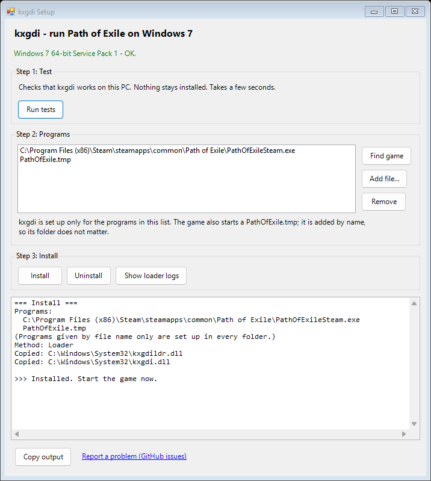

# kxgdi – fehlende gdi32-Funktionen für Windows 7 (x64)

[English version](README.md)

`kxgdi.dll` stellt Funktionen aus `gdi32.dll` bereit, die es erst ab Windows 8 gibt. Alle anderen
gdi32-Funktionen (994 Stück) werden unverändert an die echte `gdi32.dll` weitergereicht. Es funktioniert
allein mit dem mitgelieferten Lader oder zusammen mit [VxKex](https://github.com/i486/VxKex), auch mit
VxKex NEXT.

Bisher nachgerüstet:

| Funktion | Ab Windows | Nachbau unter Windows 7 |
|---|---|---|
| `D3DKMTOpenAdapterFromLuid` | 8 | Alle Grafikadapter durchgehen (SetupAPI-Geräteschnittstellen, notfalls GDI-Anzeigenamen), jeden mit `D3DKMTOpenAdapterFromDeviceName` bzw. `D3DKMTOpenAdapterFromGdiDisplayName` öffnen, LUID vergleichen, passendes Handle zurückgeben. |

Anlass: Path of Exile startet unter Windows 7 nicht mehr („Der Prozedureinsprungpunkt
D3DKMTOpenAdapterFromLuid wurde in der DLL GDI32.dll nicht gefunden“).

> [!WARNING]
> **Experimentell.** Kein Bezug zu Grinding Gear Games oder VxKex. Windows 7 wird von Path of Exile
> nicht unterstützt. kxgdi klinkt sich in den Spielprozess ein. Ein Bann ist unwahrscheinlich, aber nicht
> ausgeschlossen. Nutzung auf eigenes Risiko.

## Stand

- ✅ Unter Windows 11 gebaut und getestet: `kxgdi-test.exe` (beide Suchwege finden den Adapter, Ergebnisse
  stimmen mit der echten Windows-Funktion überein) und der Unit-Test für das Umschreiben der Importe.
- ✅ Der vollständige Lader-Test (`Test-Loader.ps1`) läuft bei jedem Build auf GitHub Actions (Windows Server).
  Dort deckt er die Importe des Programms selbst ab. Das Umbiegen bei DLLs und das Abschalten des
  Application Verifier passieren nur unter Windows 7 und lassen sich nur dort prüfen.
- ✅ Alle DLLs importieren nur Funktionen, die es unter Windows 7 gibt, und sind als Windows 6.01 markiert.
  `kxgdildr.dll` importiert nur `ntdll.dll`.
- ✅ **Erste Rückmeldung von Windows 7:** Ein Nutzer bestätigt, dass Path of Exile mit v0.2.1 und
  DXVK 1.10.3 startet ([Issue #1](https://github.com/JuliusFo/kxgdi/issues/1)). Weitere Berichte sind
  willkommen.
- ⚠️ Das Setup-Fenster (`Setup.cmd`) ist neu und unter Windows 7 noch nicht getestet. Falls es nicht
  funktioniert: die Kommandozeile verwenden und bitte ein Issue eröffnen.
- Nur 64 Bit (Path of Exile ist 64 Bit).

## Wichtig vorab

- **Grafikproblem bleibt:** Selbst wenn PoE startet, lehnt DirectX 11 unter Windows 7 die neuen
  Partikel-Shader weiterhin ab, und ältere Vulkan-Treiber stürzen ab. Für Effekte braucht es zusätzlich
  [DXVK](https://github.com/doitsujin/dxvk) 1.10.3 (letzte Version für Vulkan 1.2).
- Es kann weitere fehlende Funktionen geben. Windows meldet immer nur die erste.

## Anleitung für den Windows-7-PC

**Voraussetzungen:** Windows 7 SP1 64 Bit. VxKex wird **nicht** gebraucht.

**Release-Zip entpacken**, z. B. nach `C:\kxgdi`. Danach entweder das Setup-Fenster (einfacher) oder die
Kommandozeile verwenden.

### Mit dem Setup-Fenster



1. **`Setup.cmd` doppelklicken** und die Administrator-Abfrage bestätigen. Das Setup-Fenster öffnet sich.
2. **Schritt 1, „Run tests“:** prüft kxgdi und den Lader auf diesem PC; danach bleibt nichts installiert.
   Am Ende muss `Both tests passed` stehen. Schlägt ein Test fehl: „Copy output“ klicken, die Ausgabe in
   einem Issue posten und **nicht weitermachen**.
3. **Schritt 2, „Programs“:** Das Fenster sucht Path of Exile selbst (Steam, Standalone-Client, laufendes
   Spiel) und trägt `PathOfExile.tmp` über den Namen ein. Wird das Spiel nicht gefunden: „Add file...“
   klicken und `PathOfExile.exe` oder `PathOfExileSteam.exe` auswählen. Nicht genutzte Einträge entfernen.
4. **Schritt 3, „Install“.** Danach das Spiel starten, siehe [Nach der Installation](#nach-der-installation).

„Uninstall“ in Schritt 3 entfernt kxgdi wieder für die Programme in der Liste. „Find game“ listet auch
die Programme auf, für die kxgdi installiert ist; das klappt also auch, wenn das Spiel schon entfernt wurde. Wenn etwas schiefgeht:
„Show loader logs“, dann „Copy output“ klicken und die Ausgabe in einem Issue posten.

### Mit der Kommandozeile

1. **Selbsttest von kxgdi:** Eingabeaufforderung öffnen und ausführen:
   ```
   cd /d C:\kxgdi
   kxgdi-test.exe
   ```
   Erwartet: viele `[ OK ]`, am Ende `RESULT: all checks passed`. Die Zeile
   `No native D3DKMTOpenAdapterFromLuid (Windows 7)` ist dabei richtig.

2. **Lader-Test:** PowerShell **als Administrator** öffnen (64 Bit, nicht „x86“) und ausführen:
   ```
   cd C:\kxgdi
   powershell -NoProfile -ExecutionPolicy Bypass -File .\Test-Loader.ps1
   ```
   Das startet ein kleines Testprogramm, das die fehlende Funktion genauso importiert wie das Spiel, und
   räumt danach alles wieder auf. Erwartet: `Loader test passed`.
   Zeigt einer der Tests `[FAIL]` oder startet das Testprogramm nicht: Ausgabe in einem Issue posten und
   **nicht weitermachen**.

3. **Installieren** (PowerShell als Administrator; Pfad des Spiels anpassen, Programme mit Komma trennen):
   ```
   cd C:\kxgdi
   Set-ExecutionPolicy -Scope Process Bypass -Force
   .\Install-KxGdi.ps1 -ExePath "C:\Program Files (x86)\Steam\steamapps\common\Path of Exile\PathOfExileSteam.exe","PathOfExile.tmp"
   ```
   Die zweite Zeile erlaubt Skripte nur in diesem PowerShell-Fenster. Das Skript listet zuerst unter
   `Programs:` die Programme auf, die es einrichtet. `PathOfExile.tmp` (der Name aus der Fehlermeldung)
   braucht keinen Ordner: Der Lader wird pro Dateiname angemeldet und gilt damit überall, wo das Spiel
   die Datei startet.
   > Mit **kxgdi v0.2.0** funktioniert der einzeilige Befehl `powershell -File …` aus dessen Anleitung mit
   > zwei Pfaden nicht ([Issue #1](https://github.com/JuliusFo/kxgdi/issues/1)). Bitte die Befehle oben
   > verwenden.

   Das Skript kopiert `kxgdildr.dll` und `kxgdi.dll` nach `C:\Windows\System32` und meldet den Lader nur
   für diese Programme an. Ist VxKex (oder VxKex NEXT) für ein Programm aktiviert, wird der Lader
   dahinter eingetragen. Wer VxKex für das Spiel später an- oder abschaltet, führt das Skript erneut aus.
   Das Skript installiert nur unter Windows 7 (neuere Versionen haben die Funktion von Haus aus).

**Rückgängig machen** (PowerShell als Administrator, die ersten beiden Zeilen wie in Schritt 3):
```
.\Install-KxGdi.ps1 -ExePath "<gleiche Programme wie oben>" -Uninstall
```
Entfernt die Anmeldung des Laders und, wenn kein anderes Programm ihn nutzt, die beiden DLLs aus System32.
Vorher das Spiel schließen.

### Nach der Installation

1. **Mitlesen (optional, aber hilfreich):** Sysinternals **DebugView** starten. Der Lader meldet sich mit
   `KxGdiLdr:`-Zeilen, kxgdi mit einer `KxGdi:`-Zeile, wenn die Funktion einen Grafikadapter zum ersten
   Mal findet (spätere Aufrufe kommen ohne Ausgabe aus dem Zwischenspeicher) oder fehlschlägt. Zusätzlich
   schreibt der Lader sein Protokoll nach `C:\Windows\Temp\kxgdildr-<Programm>.log` (z. B. `kxgdildr-PathOfExile.tmp.log`),
   auch wenn das Spiel nicht startet („Show loader logs“ im Setup-Fenster). Bitte bei Fehlermeldungen mitschicken.

2. **PoE starten.** Mögliche Ergebnisse:
   - PoE startet → nächster Schritt ist DXVK für die Effekte.
   - Neue Meldung „Einsprungpunkt … nicht gefunden“ → Screenshot in einem Issue posten. Das ist die nächste
     fehlende Funktion, die nachgerüstet werden muss.
   - Absturz → Ereignisanzeige (Anwendung, „Application Error“) und Lader-Protokoll in einem Issue posten.

### Alternative: über VxKex (i486/VxKex ab 1.2.0)

Statt des Laders lässt sich kxgdi über die Einstellung `KEX_DllRewriteEntries` in
[i486/VxKex](https://github.com/i486/VxKex/releases) ab Version 1.2.0 einklinken (VxKex NEXT kennt diese
Einstellung nicht):
```
.\Install-KxGdi.ps1 -Method VxKex -ExePath "<Pfade>"
```
(PowerShell als Administrator, die ersten beiden Zeilen wie in Schritt 3 der Kommandozeile.)
Das kopiert `kxgdi.dll` nach `<VxKex>\Kex64` und aktiviert VxKex für die Programme. Rückgängig mit
demselben Befehl plus `-Uninstall`. Diese Methode braucht den vollständigen Pfad jedes Programms, auch
von `PathOfExile.tmp`: Während die Fehlermeldung des Spiels offen ist, Task-Manager → Reiter „Prozesse“
→ Rechtsklick auf `PathOfExile.tmp` → „Dateipfad öffnen“.

## Technische Details

- **Lader:** `kxgdildr.dll` wird nur für das Spiel als „Application Verifier“-Provider angemeldet
  (IFEO-Werte `GlobalFlag`, `VerifierFlags`, `VerifierDlls`; derselbe Mechanismus, den VxKex nutzt).
  Windows lädt ihn, bevor die Importe des Spiels aufgelöst werden. Er benennt in den Importtabellen des
  Spiels und aller DLLs außerhalb des Windows-Ordners (außer `Windows\Temp`) `gdi32.dll` in `kxgdi.dll` um
  (gleiche Länge, nur im Speicher) und entfernt bei geänderten Programmen die Tabelle der vorgebundenen
  Importe. Dateien auf der Platte werden nicht verändert. Weil kernel32 zu diesem Zeitpunkt noch nicht
  nutzbar ist, verwendet der Lader nur ntdll; er schreibt sein Protokoll nach `Windows\Temp` und hält es im
  Speicher für kxgdi.dll bereit, die es an DebugView ausgibt. Unter Windows 7 schaltet der Lader danach den
  Großteil des Application Verifier ab (Heap- und Handle-Überwachung), wie VxKex es auch tut.
- **Mit VxKex:** Das Installationsskript setzt `KexDll.dll` von VxKex an die erste Stelle in `VerifierDlls`
  und kxgdildr ans Ende; kxgdildr überlässt den Application Verifier dann VxKex.
- **Einschränkung:** Lädt eine DLL des Spiels eine andere DLL mit eingeschränktem Suchpfad (z. B. nur aus
  dem eigenen Ordner, ohne System32), findet sie `kxgdi.dll` nach dem Umbenennen nicht. Für Path of Exile
  ist kein solcher Fall bekannt.
- **kxgdi.dll:** enthält die nachgerüsteten Funktionen und leitet alles andere an `gdi32.dll` weiter. Die
  Weiterleitungen stammen aus der `gdi32.dll` von Windows 11 (995 Namen). Weiterleitungen auf Namen, die es
  unter Windows 7 nicht gibt, schaden nicht: Sie schlagen nur fehl, wenn ein Programm genau diese Funktion
  importiert, und das passiert ohne kxgdi genauso. Umgekehrt würde eine Funktion fehlen, die es nur in der
  `gdi32.dll` von Windows 7 gibt; bekannt ist keine (alte Namen wurden stichprobenartig geprüft). Mit einer
  `gdi32.dll` von Windows 7 schließt `tools\gen-def.ps1 -Gdi32 <Windows-11-Datei>, <Windows-7-Datei>` diese
  Lücke. Exporte ohne Namen (nur über ihre Nummer erreichbar, Windows-intern) werden nicht weitergeleitet.
- **Leistung:** Der erste Aufruf für einen Grafikadapter geht alle Adapter durch; das Ergebnis wird
  zwischengespeichert, spätere Aufrufe öffnen nur noch diesen einen Adapter.

## Bauen

Voraussetzung: Visual Studio bzw. Build Tools mit den MSVC-x64-Werkzeugen. Ein Windows-SDK ist **nicht**
nötig, denn der Code nutzt keine SDK-Header und keine C-Laufzeitbibliothek, und die Import-Bibliotheken
werden aus `imports\*.def` erzeugt.

```
pwsh .\build.ps1 -Test              # baut alles nach out\x64 und testet
pwsh .\build.ps1 -RegenerateDef     # Weiterleitungsliste aus der lokalen gdi32.dll neu erzeugen
pwsh .\tools\gen-def.ps1 -Gdi32 C:\Windows\System32\gdi32.dll, D:\win7\gdi32.dll   # Win7-Exporte ergänzen
pwsh .\tools\package.ps1            # dist\kxgdi-win7-x64.zip
```

`build.ps1 -Test` führt `kxgdi-test.exe`, `kxgdildr-unit.exe`, `test\Test-InstallerArgs.ps1` (wie der
Installer seine Pfade liest, wenn er aus PowerShell oder cmd.exe gestartet wird) und
`install\Setup-KxGdi.ps1 -SelfTest` (Spielsuche, Übergabe an den Installer, Aufbau des Fensters) aus, als
Administrator zusätzlich den
vollständigen `test\Test-Loader.ps1`. Auf Build-Servern ohne Grafikadapter läuft der kxgdi-Test mit `/ci`
und überspringt die Adapter-Prüfungen.

Release-Dateien baut GitHub Actions (`.github\workflows\build.yml`): Workflow von Hand mit einer Version wie
`v1.1.0` starten. Er legt einen Release-Entwurf mit Zip, Prüfsummen und dem passenden Abschnitt aus
[CHANGELOG.md](CHANGELOG.md) an. Erst beim Veröffentlichen des Entwurfs entsteht der Tag, und das Release
wird zum neuesten („Latest“). Die Option „pre-release“ ist nur für Testversionen gedacht: GitHub zeigt
Vorabversionen auf der Startseite des Repos nicht als neuestes Release an.

Weitere Funktionen nachrüsten: In `src\kxgdi.c` als `Ext_<Name>` implementieren, in `tools\gen-def.ps1` in
`$Implemented` eintragen, `build.ps1 -RegenerateDef -Test` ausführen.

| Datei | Inhalt |
|---|---|
| `src\kxgdi.c` | Nachgerüstete Funktionen |
| `src\kxgdi.def` | Exporte (generiert) |
| `src\kxgdildr.c` | Eigenständiger Lader (Application-Verifier-Provider, nur ntdll) |
| `src\kxtypes.h` | Minimale Windows-/NT-Typen für Lader und Tests |
| `imports\*.def` | Import-Bibliotheken ohne SDK (`gdi32.def` generiert) |
| `test\test.c` | Selbsttest von kxgdi.dll, läuft unter Windows 7 und neuer |
| `test\ldrunit.c` | Unit-Test für das Umschreiben der Importe |
| `test\ldrtest.c`, `test\ldrtest-dll.c`, `test\Test-Loader.ps1` | Vollständiger Lader-Test (Administrator) |
| `test\Test-InstallerArgs.ps1` | Test der Befehlszeile des Installers (ändert nichts) |
| `install\Install-KxGdi.ps1` | Installation (PowerShell 2.0) |
| `install\Setup.cmd`, `install\Setup-KxGdi.ps1` | Setup-Fenster (WinForms, PowerShell 2.0); `-Snapshot <png>` rendert es für `docs\setup.png` |
| `tools\gen-def.ps1`, `tools\package.ps1` | Generator und Paketbau |
| `.github\workflows\build.yml` | CI-Build und Releases |

## Lizenz

[MIT](LICENSE). Kein Bezug zu Microsoft, Grinding Gear Games oder den VxKex-Autoren.
